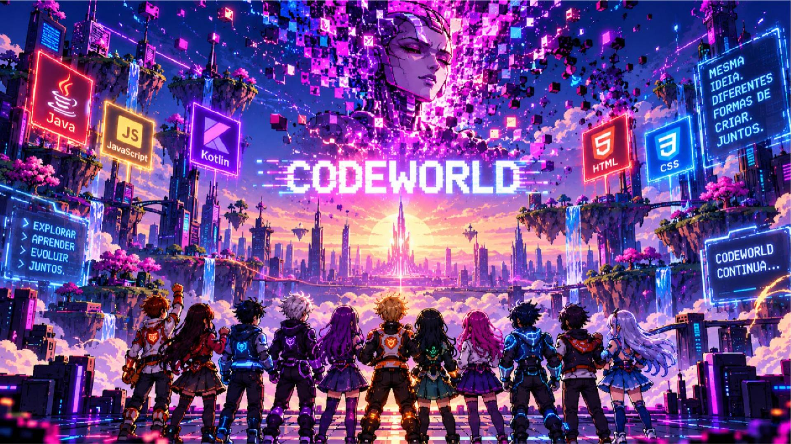
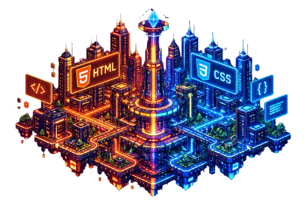
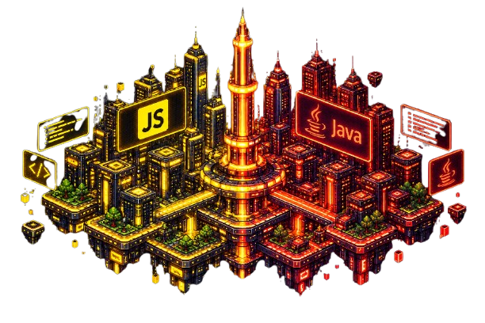
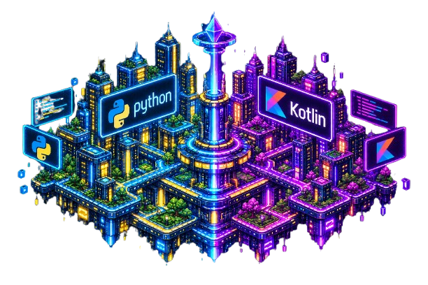
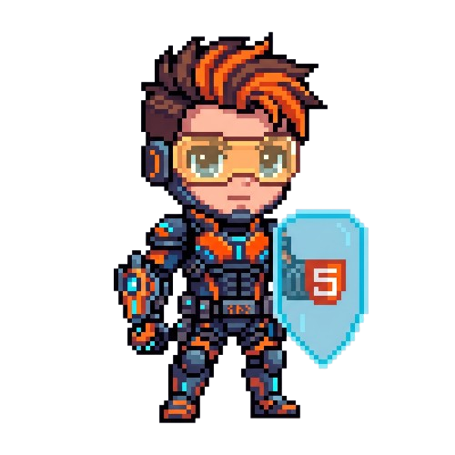
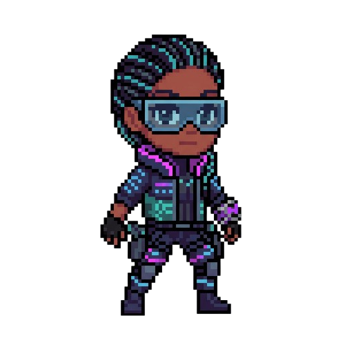
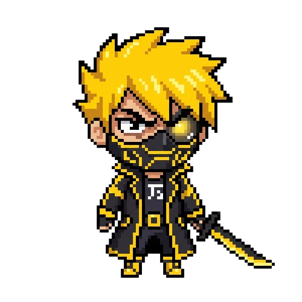
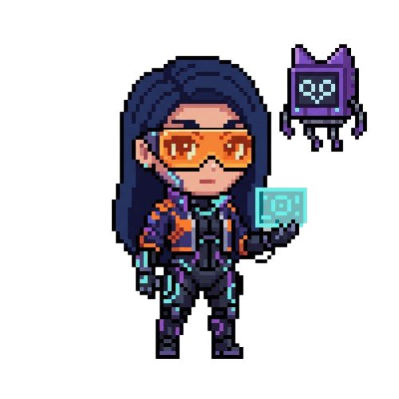

<p align="center">
  
</p>

<h1 align="center">CodeWorld</h1>

<p align="center">
  <strong>Aprender programação. Explorar um universo. Evoluir com conhecimento.</strong>
</p>

<p align="center">
  Projeto acadêmico de desenvolvimento web que conecta educação, narrativa e um RPG interativo.
</p>

<p align="center">
  <a href="#sobre-o-projeto">Apresentação</a> ·
  <a href="#personagens">Personagens</a> ·
  <a href="#funcionalidades">Funcionalidades</a> ·
  <a href="#tecnologias">Tecnologias</a> ·
  <a href="#como-executar">Como executar</a>
</p>

<p align="center">
  <strong>6 personagens</strong> · <strong>54 aulas</strong> · <strong>31 operações na história</strong> · <strong>3 missões diárias</strong>
</p>

---

## Sobre o projeto

O **CodeWorld** é uma plataforma educacional que transforma o estudo de tecnologias da web e de programação em parte de uma aventura. O usuário conhece os conteúdos, resolve atividades e acompanha seu progresso por meio de personagens, missões e desafios dentro de um universo próprio.

A proposta é aproximar o aprendizado da prática: o conteúdo estudado tem uma consequência visível na experiência. **Concluir aulas desenvolve o personagem; resolver missões fornece recursos para enfrentar os desafios do RPG.** Assim, a plataforma busca estimular a curiosidade, a continuidade dos estudos e a resolução de problemas.

O projeto reúne um portal de apresentação, trilhas de aprendizagem, atividades de código e um jogo com exploração e combate por turnos. Sua identidade visual combina **pixel art, estética cyberpunk, cores neon e animações**, mantendo uma linguagem comum entre as páginas e a experiência de jogo.

### Objetivos educacionais

- Apresentar fundamentos de HTML, CSS, JavaScript, Python, Java e Kotlin a quem está começando.
- Relacionar explicações e exemplos a questionários e atividades práticas.
- Incentivar a leitura do problema, a experimentação e a revisão de respostas.
- Organizar o aprendizado em etapas com critérios claros de conclusão.
- Aplicar conhecimentos de desenvolvimento web em uma experiência interativa completa.

HTML e CSS são trabalhados como linguagens de marcação e de estilo; JavaScript, Python, Java e Kotlin compõem as trilhas de linguagens de programação.

## O universo CodeWorld

Na história, CodeWorld é uma cidade onde sistemas, dados e pessoas vivem conectados. Uma **Super IA**, criada para organizar a informação, passa a reproduzir erros, boatos e vieses aprendidos sem critérios. Para restaurar a cidade, o jogador se une à resistência e reconecta os agentes ligados às diferentes tecnologias.

A narrativa dá contexto às atividades: compreender estruturas, identificar erros e reconstruir soluções faz parte da missão de recuperar esse mundo digital.

| Estrutura e estilo | Interação e sistemas | Dados e conexão |
|:---:|:---:|:---:|
|  |  |  |
| **HTML · CSS** | **JavaScript · Java** | **Python · Kotlin** |

<p align="center"><em>Artes de ambientação utilizadas no portal do projeto.</em></p>

## Personagens

Cada personagem representa uma tecnologia, possui uma trilha de estudos e desempenha um papel na equipe. A seleção combina identidade visual, conteúdo educacional e estratégia de combate.

<table>
  <tr>
    <td align="center" width="33%">
      <br>
      <strong>HTML</strong><br>
      Estrutura e semântica<br>
      <sub>Classe: Vanguarda</sub>
    </td>
    <td align="center" width="33%">
      <br>
      <strong>CSS</strong><br>
      Estilo e organização visual<br>
      <sub>Classe: Vanguarda</sub>
    </td>
    <td align="center" width="33%">
      <br>
      <strong>JavaScript</strong><br>
      Lógica e interatividade<br>
      <sub>Classe: Combatente</sub>
    </td>
  </tr>
  <tr>
    <td align="center">
      <br>
      <strong>Python</strong><br>
      Dados e resolução de problemas<br>
      <sub>Classe: Suporte</sub>
    </td>
    <td align="center">
      <br>
      <strong>Java</strong><br>
      Tipos, métodos e exceções<br>
      <sub>Classe: Combatente</sub>
    </td>
    <td align="center">
      <br>
      <strong>Kotlin</strong><br>
      Funções, coleções e valores nulos<br>
      <sub>Classe: Suporte</sub>
    </td>
  </tr>
</table>

## Aprender para evoluir

A progressão conecta quatro ações:

1. **Estudar:** escolher um personagem, ler a aula e observar os exemplos.
2. **Praticar:** responder ao questionário ou cumprir os critérios da atividade de código.
3. **Evoluir:** concluir a aula, aumentar o nível do personagem e avançar na trilha.
4. **Aplicar:** montar a equipe, resolver missões e utilizar os recursos conquistados no RPG.

São **nove aulas por personagem**, totalizando **54 aulas**. O personagem começa no nível 1 e pode chegar ao nível 10 pela conclusão da trilha. Abrir uma aula não concede evolução: a atividade precisa ser concluída. As aulas permanecem disponíveis para revisão, sem repetir recompensas.

## Funcionalidades

| Área | Experiência oferecida |
|---|---|
| **Portal e universo** | Apresentação do projeto, história, personagens, mapa interativo e acervo de conteúdos. |
| **Personagens e formação** | Academia integrada às fichas dos personagens, com aulas sequenciais, atividades e acompanhamento da evolução. |
| **Central de missões** | Seis desafios permanentes e três diários, com editor, dicas, verificação da solução e resgate de recompensas. |
| **Modo história** | Exploração de mapas, diálogos, terminais educativos e 31 operações distribuídas entre os capítulos e o Núcleo final. |
| **Combate por turnos** | Equipes de até três personagens, seleção de alvos, habilidades, defesa, efeitos de estado e animações. Os ataques são executados diretamente. |
| **Campanha Nexus** | Quatro operações que combinam perguntas e atividades de código com validação antes da conclusão. |
| **Equipe, loja e inventário** | Recrutamento de personagens, organização da equipe e uso de consumíveis durante as batalhas. |
| **Conta e progresso** | Cadastro, autenticação em duas etapas e persistência individual de aulas, moedas, itens e campanha. |
| **Tutorial e preferências** | Guia inicial, opção de rever as orientações e controles de tema, contraste, tamanho da fonte e movimento. |

### Missões com recompensas úteis

As missões diárias são renovadas automaticamente à **meia-noite de Brasília (UTC−03)**, a partir de modelos com parâmetros variados. Elas não dependem de geração por inteligência artificial.

O usuário escreve a solução, executa a verificação e, quando os critérios são atendidos, resgata os suprimentos. As recompensas entram no inventário da conta e podem ser usadas nas batalhas:

| Item | Utilidade |
|---|---|
| **Patch de reparo** | Recupera parte da vida de um aliado. |
| **Antídoto** | Remove efeitos negativos. |
| **Bateria de energia** | Recupera energia para utilizar habilidades. |
| **Escudo de dados** | Reduz temporariamente o dano recebido. |

As aulas concedem moedas para a loja. As missões e campanhas concedem itens, conectando o estudo, os desafios e as decisões durante o combate.

## Tecnologias

| Tecnologia | Aplicação no projeto |
|---|---|
| **HTML5** | Estrutura das páginas e organização do conteúdo. |
| **CSS3** | Identidade visual, layouts responsivos, transições e animações da interface. |
| **JavaScript com módulos ES** | Navegação, interações, missões, integração com a API e lógica visual do jogo. |
| **Canvas 2D** | Desenho dos mapas, sprites, arena e efeitos de combate. |
| **Python 3.10+** | Servidor HTTP, autenticação, regras de progresso e validação das ações. |
| **SQLite** | Persistência de usuários, sessões e progresso de cada conta. |
| **JSON** | Organização das aulas, personagens, inimigos, mapas e campanhas. |
| **unittest** | Testes automatizados das regras e dos fluxos da API. |

O navegador apresenta o portal e o jogo, enquanto o servidor Python valida as ações e registra o progresso no SQLite. Essa divisão permite compartilhar a mesma conta, o mesmo inventário e a mesma evolução entre as diferentes áreas do site.

O núcleo do projeto utiliza recursos nativos do navegador e a biblioteca padrão do Python. **Não é necessário instalar Node.js, npm ou pacotes com pip para executar a experiência principal.**

<details>
<summary><strong>Organização dos arquivos</strong></summary>

| Caminho | Responsabilidade |
|---|---|
| `nexus/`, `universo/`, `personagens/`, `mapa/`, `missoes/`, `arquivos/`, `perfil/` | Seções do portal. |
| `comum/` | Estilos, componentes e comportamentos compartilhados. |
| `rpg/` | Interface, módulos do jogo e sprites. |
| `img/` | Imagens e mídias do projeto. |
| `data/` | Conteúdo em JSON e banco de jogadores criado durante o uso. |
| `server.py` | Servidor HTTP e rotas da API. |
| `combat.py`, `campaign.py` | Regras de combate e progressão da campanha. |
| `training.py`, `missions.py`, `practice.py`, `items.py` | Aulas, missões, validação das atividades e itens. |
| `tests/`, `docs/` | Testes e documentação. |

</details>

## Como executar

**Requisitos:** Python 3.10 ou superior e um navegador atualizado. A versão documentada é a **v9.0.1**, com testes executados em Python 3.12.

### Windows

1. Extraia todo o projeto para uma pasta.
2. Abra a pasta que contém `server.py` e execute **`INICIAR-WINDOWS.bat`**.
3. Acesse **http://127.0.0.1:8000/** e mantenha a janela do servidor aberta.

Também é possível iniciar pelo terminal, dentro da pasta do projeto:

```powershell
py -3 server.py
```

### Linux e macOS

```bash
python3 server.py
```

Para encerrar, pressione **Ctrl+C** no terminal. O site deve ser acessado pelo servidor, pois contas, missões e progresso dependem da API.

### Primeiro acesso

O tutorial apresenta as áreas principais. Para salvar a evolução, crie uma conta em **Entrar / Cadastrar** e configure a chave exibida em um aplicativo autenticador. O acesso utiliza códigos temporários de seis dígitos; esses códigos não são enviados por e-mail.

Depois, abra **Jogar RPG → Personagens → Estudar e evoluir** para iniciar uma trilha ou entre em **Missões** para conhecer o terminal de atividades.

## Demonstração do projeto

Uma apresentação pode percorrer os seguintes pontos:

1. **Identidade e proposta:** mostrar o portal, a narrativa e a relação entre tecnologias e personagens.
2. **Aprendizagem:** concluir uma atividade e observar a evolução do personagem.
3. **Prática de código:** testar uma solução no terminal, analisar o resultado e resgatar os itens de uma missão.
4. **Aplicação no jogo:** explorar o mapa, entrar em combate e demonstrar habilidades, alvos e inventário.
5. **Persistência:** atualizar a página e verificar que o progresso da conta foi mantido.

Esse percurso evidencia como interface, conteúdo educacional, regras do jogo e armazenamento de dados trabalham em conjunto.

## Qualidade e validação

A versão v9.0.1 possui registro de **46 testes automatizados aprovados**, abrangendo autenticação, separação entre contas, evolução pelas 54 aulas, missões, recompensas, combate e uma campanha completa de 31 operações pela API.

A suíte também inclui uma verificação de inicialização com a codificação padrão do Windows simulada, preservando os acentos dos conteúdos. Os testes registrados foram executados em Linux com Python 3.12; os detalhes e limites da verificação estão em [Testes e validações](./docs/TESTES.md).

Para executar os testes no Windows:

```powershell
py -3 -m unittest discover -s tests -v
```

No Linux ou macOS, substitua `py -3` por `python3`.

<details>
<summary><strong>Escopo da versão e recursos opcionais</strong></summary>

O projeto está preparado para execução local. As atividades verificadas de JavaScript e Python utilizam um avaliador limitado aos conteúdos previstos em cada desafio; elas não equivalem a um interpretador completo dessas linguagens.

O laboratório livre de Python utiliza Pyodide e precisa de internet para carregar o interpretador. A execução de linguagens compiladas, como Java e Kotlin, e o tutor de IA dependem de serviços externos configurados separadamente. Esses serviços são opcionais e não são necessários para iniciar o jogo.

</details>

## Documentação complementar

- [Arquitetura e organização do sistema](./docs/ARQUITETURA.md)
- [Testes e validações](./docs/TESTES.md)
- [Evolução da versão atual](./docs/ALTERACOES-v9.md)
- [Origem e organização dos recursos visuais](./docs/ASSETS.md)

---

<p align="center">
  <strong>CodeWorld</strong><br>
  <em>Conhecimento que se transforma em evolução.</em>
</p>
